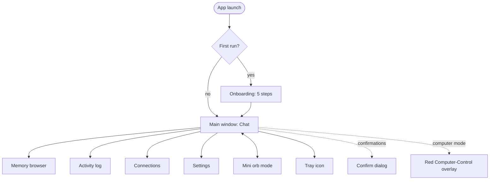
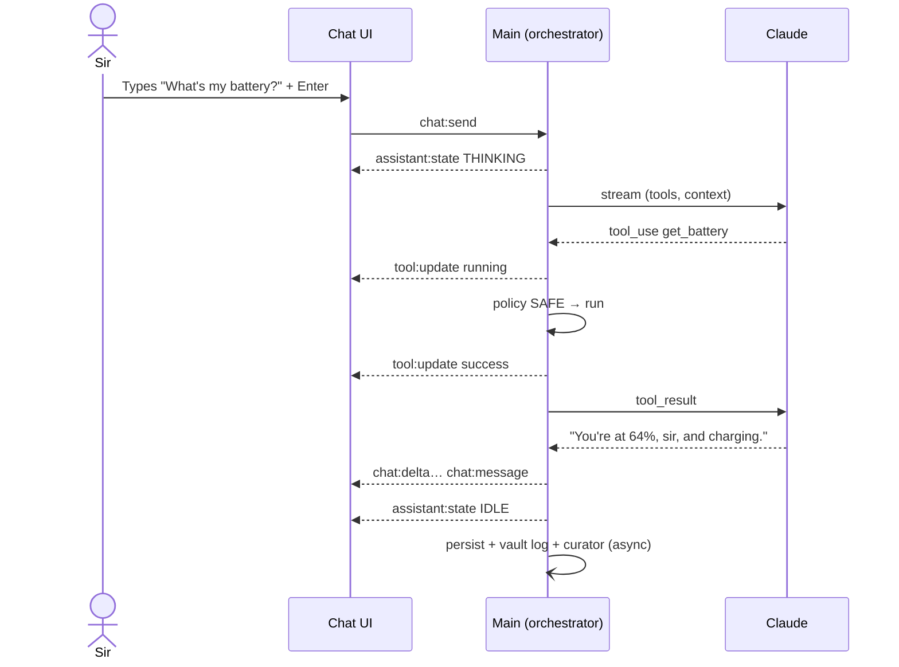
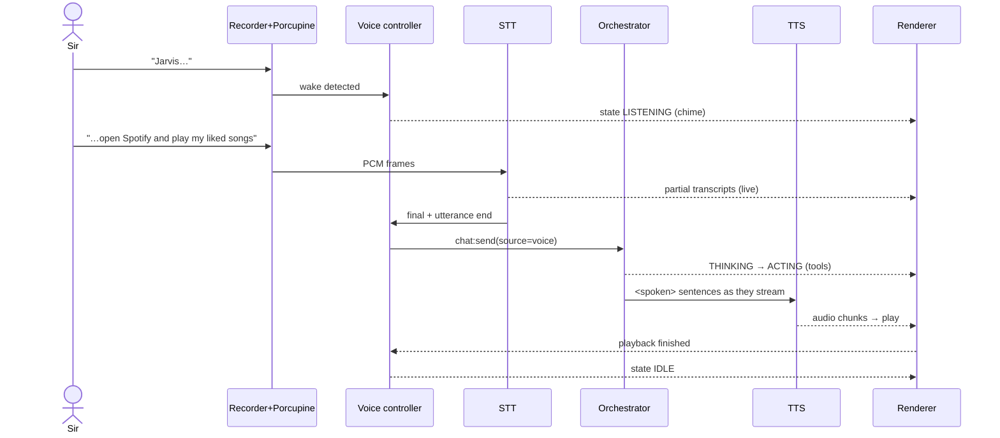
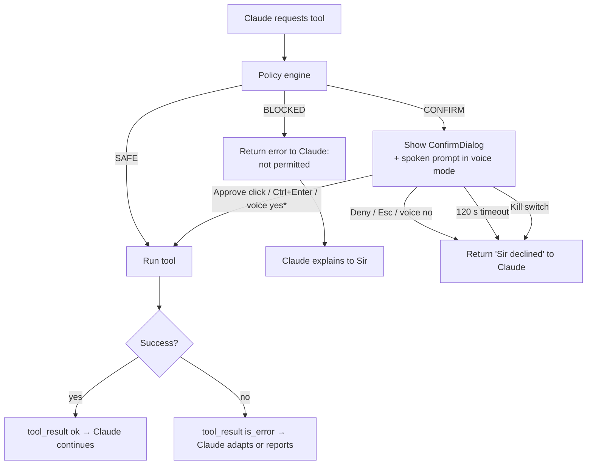
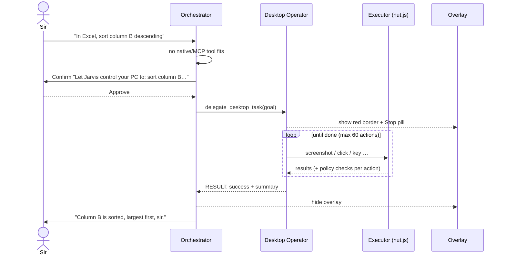

# App Flow — JARVIS Desktop

| Field | Value |
|---|---|
| Status | v1.0 |
| Last updated | 2026-10-06 |
| Related | [Design-system](Design-system.md) · [Architecture](Architecture.md) §4, §8 · [Security](Security.md) |

---

## 1. Screen Map

## 2. App Launch

1. Acquire single-instance lock; if another instance exists → focus it and exit.
2. Load settings + secrets status; open DB (run migrations, backup if > 24 h, `quick_check`).
3. If onboarding not complete → onboarding window. Else:
4. Ensure vault skeleton exists; start vault watcher; index changed files.
5. Start MCP servers (enabled ones) in parallel; status events stream to UI.
6. Register global hotkeys; create tray.
7. If voice mode = wake → start recorder + Porcupine.
8. Start scheduler (fire overdue reminders with "missed" note).
9. Show main window (or start minimised to tray if "start hidden" is set).

## 3. Onboarding (first run, target < 5 minutes)

| Step | Screen content | Validation | Skippable |
|---|---|---|---|
| 1. Welcome | What Jarvis can do, what it never does (no payments, no passwords), local-first data | — | No |
| 2. Brain | Paste Anthropic API key; link to Console; recommend setting a monthly spend limit there; set app budget (default $2/day, $30/month) | Test call with Haiku ("Reply OK"), shows ✓ or the error | No |
| 3. Memory vault | Choose folder (default `Documents\JarvisBrain`); "Open in Obsidian" button; create skeleton; ask Sir's preferred name is "Sir" (fixed persona) and 3 optional quick facts (role, main project, city) → written to `About Sir.md` | Folder writable | Facts skippable |
| 4. Voice | Mic picker + level meter; Picovoice key (optional); STT key (optional); test "Say: Jarvis, what time is it?"; voice mode choice (Off / Press-to-talk / Wake word) | If keys missing → voice mode limited to Off | Yes |
| 5. Safety | Explains SAFE / CONFIRM / BLOCKED with examples; allowed folders list (editable); kill-switch hotkey demo | Sir clicks "I understand" | No |

Finish → main window with empty-state orb and greeting.

## 4. Text Turn (happy path)

## 5. Voice Turn

Details:
- LISTENING times out after 8 s of no speech → IDLE with a soft "cancel" chime.
- Transcript is shown in the composer area while listening; Sir can press Esc to cancel.
- If the transcript is empty or under 2 characters → "Sorry, sir, I didn't catch that." (spoken), back to LISTENING once, then IDLE.
- Press-to-talk: hotkey → LISTENING (same flow, no wake word). Hotkey again → cancel.

### 5.1 Barge-in
SPEAKING + (wake word or PTT hotkey) → stop TTS within 200 ms → LISTENING. The interrupted reply is kept in chat marked "(interrupted)".

### 5.2 "Jarvis, stop" / "never mind"
Recognised locally from the final transcript (exact phrases list) → kill-switch-lite: cancel current turn and TTS (doesn't stop MCP servers).

## 6. Confirmation Flow

\* Voice approval only for non-destructive actions. Destructive actions need a click or `Ctrl+Enter`.

Multiple CONFIRM tools in one Claude turn are asked **one at a time, in order**. If one is denied, later dependent ones in a computer/browser batch are not run (halt text), and other independent ones are still asked.

## 7. Memory Flows

### 7.1 Explicit "remember"
Sir: "Remember that Pradyumna handles the database for Avaan Website."
→ Claude calls `memory` (view `/memories/People`, then create `/memories/People/Pradyumna.md`) → vault write (redact, atomic) → index → reply "Noted, sir." → curator later sees the fact already exists → NOOP.

### 7.2 Automatic curation
After a turn completes and 10 s pass with no new message → curator (Haiku) → ops → apply (≥ 0.8 confidence) or queue for review → toast "Jarvis updated 2 memories" (click → Memory browser with highlights).

### 7.3 Recall
Sir: "Who handles the database for our website?"
→ context builder FTS hits `People/Pradyumna.md` → injected in dynamic block → Claude answers without tools.

### 7.4 Forget
Sir: "Forget everything about my old flat."
→ Claude searches memory → proposes edits/deletes → `memory delete` = SAFE but **audit-logged** and moved to vault `.trash/` (recoverable in Obsidian) → reply lists what was removed.
From UI: Memory browser → Forget → confirm dialog → same.

### 7.5 Sir edits in Obsidian
Watcher detects change → re-index → next turn uses updated facts. If Jarvis later writes the same file and the hash changed externally, Jarvis appends under "## Updates from Jarvis" instead of overwriting.

## 8. Connections (MCP) Flow

1. Connections → "Add connection" → choose from presets (Playwright, GitHub, Notion, Filesystem) or "Custom".
2. Form: name, command/URL, args, secrets (stored encrypted), trust level.
3. "Test" → spawn/connect → list tools → show tools with default tier CONFIRM; Sir can mark read-only tools SAFE.
4. Save → server enabled → tools available from the next turn.
5. Failures show the server's stderr tail (redacted) and a "Retry" button.

## 9. Computer-Control Flow (Phase 6)

Stop paths: kill switch, Stop pill, max actions, operator reports blocked (login/payment/UAC), 3 consecutive errors.

## 10. Reminders & Routines

- "Remind me at 6 pm to call the courier office" → `set_reminder` (SAFE) → DB + `Tasks/Reminders.md` → at 18:00: Windows notification + spoken "Sir, a reminder: call the courier office." (if not in a call/DND, P2) → buttons Done / Snooze 10 min.
- "Start work mode" → matches routine trigger → `run_routine` → each step goes through policy individually → summary reply.

## 11. Kill Switch Flow

From any state: `Ctrl+Alt+Shift+X` / tray "Stop everything" / overlay Stop pill / "Jarvis, stop everything".
→ abort Claude stream → deny pending confirmations → abort running tools (kill PowerShell processes, release nut.js keys/buttons) → stop TTS → hide overlay → state IDLE → toast "All activity stopped" → audit entry.

## 12. Error Flows

| Error | User sees | Recovery |
|---|---|---|
| Invalid API key (401) | Error card: "Claude rejected the API key." + "Open Settings → Brain" | Replace key |
| Budget reached | "Today's budget ($2.00) is used up." + "Adjust budget" | Raise budget or wait until tomorrow |
| Network offline | Status bar "Offline"; sending shows "You're offline. I'll be able to help once the connection is back." | Auto-detect reconnect |
| Claude overloaded | "Claude is busy. Retrying…" then card with Retry | Retry button |
| Mic not found | Voice toggle disabled with tooltip "No microphone detected" | Plug in → auto-detect (poll 5 s) |
| STT provider error | Toast + switch to text input focus | Fallback provider if configured |
| TTS error | Silent fallback to Windows voice; toast once per session | — |
| MCP server crashed | Connections badge red; tools from that server removed until reconnect | Auto-retry ×5, then manual |
| Tool timeout | Tool card error "Timed out after 30 s" → Claude adapts | — |
| Vault folder missing | Toast "Memory vault not found; recreated at …" | Choose another folder in Settings |
| DB corruption | Modal: "Restore from backup of <date>?" | Restore / start fresh |

## 13. Shutdown

Window close → minimise to tray (default) or quit (setting). Quit: stop recorder → abort turns → close MCP clients (SIGTERM, 3 s, then kill) → flush logs → close DB → exit.
