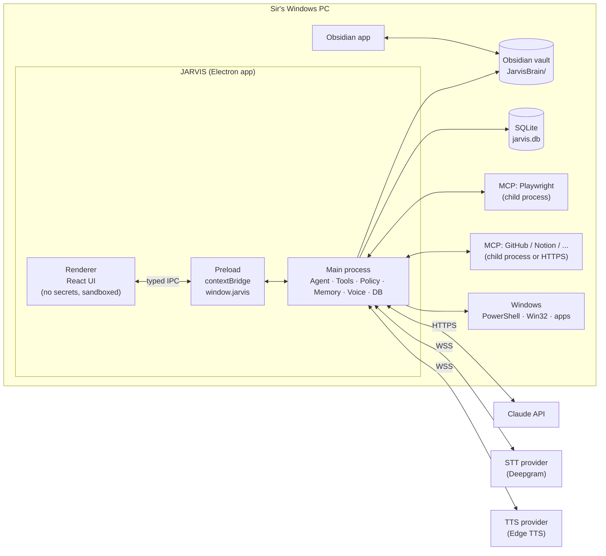
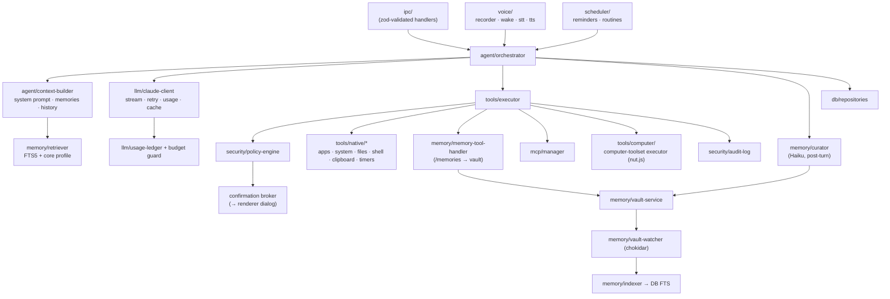
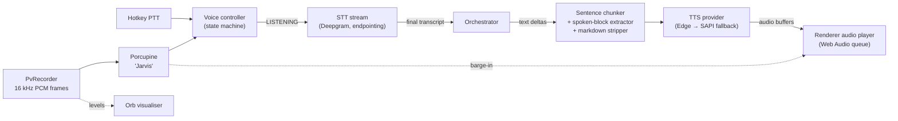
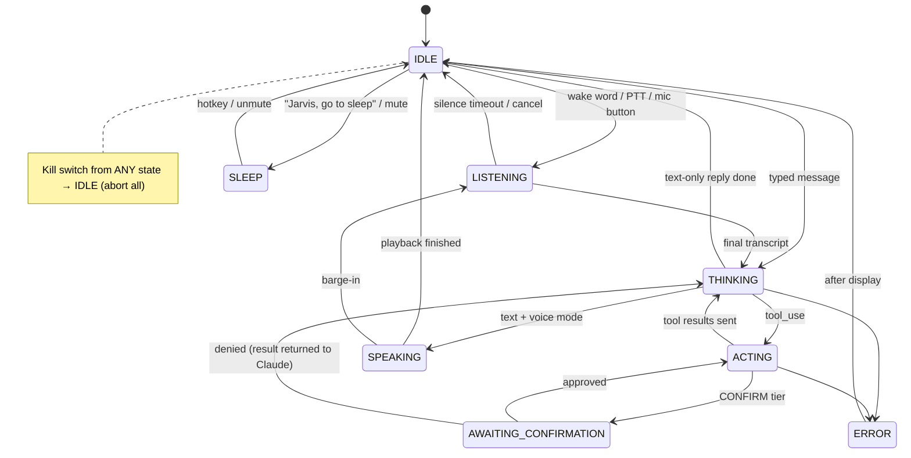

# Architecture — JARVIS Desktop

| Field | Value |
|---|---|
| Status | v1.0 |
| Last updated | 2026-10-06 |
| Related | [TRD](TRD.md) · [API-Guide](API-Guide.md) · [Database](Database.md) · [Security](Security.md) · [App-flow](App-flow.md) |

---

## 1. Big Picture



**Key principle:** the **main process is the only trusted zone**. It owns secrets, network calls, tools, and policy. The renderer is a display + input surface only.

## 2. Process Model

| Process | Responsibilities | Trust |
|---|---|---|
| **Main** (Node) | App lifecycle, windows, tray, global hotkeys, agent orchestrator, Claude client, tool registry + executor, policy engine, MCP manager, memory/vault service, DB, voice pipeline (mic → wake → STT; TTS fetch), scheduler (reminders), logging, audit | Trusted |
| **Preload** | Exposes a minimal, typed `window.jarvis` API via `contextBridge`; no Node access leaks | Bridge |
| **Renderer** (Chromium, sandboxed) | React UI: chat, orb, activity, confirmations, settings, memory browser; plays TTS audio buffers | Untrusted-by-default |
| **Overlay window** (renderer) | Always-on-top mini orb + "Computer Control" red border | Untrusted-by-default |
| **MCP child processes** | Third-party tool servers (stdio) | Untrusted |
| **PowerShell child processes** | Short-lived, per tool call | Controlled |

## 3. Main-Process Modules



| Module | Responsibility | Key files |
|---|---|---|
| `agent/` | Turn handling, agent loop, model routing, sub-agent delegation, prompt assembly | `orchestrator.ts`, `agent-loop.ts`, `model-router.ts`, `prompts/*.ts`, `context-builder.ts` |
| `llm/` | Claude SDK wrapper: streaming, retries, prompt caching, usage accounting, budget guard | `claude-client.ts`, `usage-ledger.ts`, `budget-guard.ts` |
| `tools/` | Tool interface, registry, executor, native tools, computer-use executor | `types.ts`, `registry.ts`, `executor.ts`, `native/**`, `computer/**` |
| `security/` | Policy engine, path guard, shell guard, redaction, untrusted wrapping, audit log, kill switch | `policy-engine.ts`, `path-guard.ts`, `shell-guard.ts`, `redact.ts`, `audit.ts`, `kill-switch.ts` |
| `mcp/` | Spawn/connect MCP servers, list tools, namespace them, call them, health | `manager.ts`, `config.ts` |
| `memory/` | Vault I/O, memory tool handler, curator, retriever, indexer, watcher, conversation logger | `vault-service.ts`, `memory-tool-handler.ts`, `curator.ts`, `retriever.ts`, `indexer.ts`, `conversation-logger.ts` |
| `voice/` | PvRecorder capture, Porcupine wake, STT providers, TTS providers, sentence chunker, voice state machine | `recorder.ts`, `wake-word.ts`, `stt/*.ts`, `tts/*.ts`, `voice-controller.ts` |
| `db/` | Connection, migrations, repositories | `connection.ts`, `migrations/*.sql`, `repos/*.ts` |
| `settings/` | Settings CRUD, secrets via safeStorage | `settings-service.ts`, `secrets.ts` |
| `scheduler/` | Reminders and timers (persisted), routine runner | `scheduler.ts`, `routines.ts` |
| `windows/` | Main window, overlay, tray, hotkeys | `main-window.ts`, `overlay-window.ts`, `tray.ts`, `hotkeys.ts` |

## 4. Request Lifecycle (one user turn)

```mermaid
sequenceDiagram
    autonumber
    participant U as Sir
    participant UI as Renderer
    participant O as Orchestrator
    participant C as Context Builder
    participant L as Claude API
    participant X as Tool Executor
    participant P as Policy Engine
    participant T as Tool (native/MCP/computer)
    participant Mem as Memory (vault+DB)

    U->>UI: speaks / types "Open VS Code and my Avaan repo"
    UI->>O: jarvis.chat.send(text, source)
    O->>C: build(conversationId, text)
    C->>Mem: core profile + FTS top-k memories
    C-->>O: system prompt + tools + history
    loop Agent loop (max 25)
        O->>L: messages.stream(...)
        L-->>UI: text deltas (via O)
        L-->>O: stop_reason = tool_use (one or more blocks)
        loop each tool_use block, in order
            O->>X: execute(block)
            X->>P: evaluate(tool, input)
            alt BLOCKED
                P-->>X: deny (reason)
            else CONFIRM
                P->>UI: confirmation request
                U->>UI: Approve / Deny
                UI-->>P: decision
            else SAFE
                P-->>X: allow
            end
            X->>T: run (timeout, abort signal)
            T-->>X: result / error
            X->>Mem: audit + tool_calls row
            X-->>O: tool_result (wrapped if untrusted)
        end
        O->>L: continue with tool_results
    end
    L-->>O: final text (stop_reason = end_turn)
    O->>Mem: persist messages; append vault daily log
    O-->>UI: done; voice → TTS
    O-)Mem: (async) curator extracts memories (Haiku)
```

## 5. Agent Loop Design

Pseudocode (implementation in [API-Guide](API-Guide.md) §3):

```text
turn(userMessage):
  ctx = contextBuilder.build()
  for i in 1..MAX_ITER:
     check killSwitch / abortSignal / budgetGuard
     response = claude.stream(ctx)            # UI receives deltas live
     ctx.append(assistant: response.content)
     toolUses = response.content.filter(type == tool_use)
     if toolUses empty: break                 # end_turn
     results = []
     failed = false
     for block in toolUses (sequential, in order):
        if failed: results.push(haltResult(block)); continue
        r = executor.run(block)               # policy → confirm → run → audit
        results.push(r)
        if r.is_error and block is part of computer/browser batch: failed = true
     ctx.append(user: results)                # one tool_result per tool_use
  persist(); log to vault; schedule curator
```

Rules:
- **Every** `tool_use` block gets exactly one `tool_result` (the API rejects requests otherwise).
- Blocks execute **sequentially in order** (computer/browser batches depend on order). Read-only native tools *may* run in parallel in P2.
- Toolset results (computer/browser) must echo `toolset_name`.
- Denied actions return `is_error: true` with a clear reason ("Sir declined this action") so Claude adapts instead of retrying.

## 6. Tool System

```text
Tool = {
  name: "open_app",                  // snake_case, unique
  description: "...",                // written for Claude: when/why to use
  inputSchema: ZodSchema,            // → JSON Schema for the API
  tier: "SAFE" | "CONFIRM" | "BLOCKED" | (input) => Tier,   // static or computed
  source: "native" | "mcp" | "anthropic",
  untrustedOutput: boolean,          // wrap result in <untrusted_content>
  timeoutMs: number,
  summarize(input): string,          // human sentence for confirmations/activity
  run(input, ctx: {signal, logger}): Promise<ToolOutput>
}
```

Sources:
1. **Native tools**: TS functions (PowerShell/Electron/nut.js).
2. **MCP tools**: discovered at runtime, namespaced `mcp__<server>__<tool>`, tier from server config + per-tool overrides (default CONFIRM unless marked read-only).
3. **Anthropic-defined tools**: memory tool (client-executed), computer-use toolset (client-executed), web search (server-executed, no local handler).

## 7. Memory Architecture (three layers)

| Layer | What | Where | Lifetime |
|---|---|---|---|
| **Working memory** | Current conversation messages + rolling summary when long | In-process + `messages` table | Conversation |
| **Episodic memory** | Every conversation, raw + daily Markdown log | SQLite `messages` (raw, FTS) + `Conversations/YYYY/MM/YYYY-MM-DD.md` | Forever (configurable retention) |
| **Semantic memory** | Curated facts: about Sir, people, projects, preferences, routines | `JarvisBrain/Memory/**.md` (source of truth) + `memories` FTS index | Until edited/forgotten |

Write paths into semantic memory:
1. **Claude memory tool** (model decides during the turn).
2. **Curator** (Haiku after each turn → ADD / UPDATE / DELETE / NOOP ops, mem0-style).
3. **Sir** edits files directly in Obsidian → watcher → re-index.

Read path (each turn): `About Sir.md` + `Preferences.md` (always, small) + FTS top-k over memories + episodic search when the question references the past ("last week", "we decided").

Vault layout is defined in [Database.md](Database.md) §8.

## 8. Voice Pipeline



### Assistant state machine



The state is owned by `voice/voice-controller.ts` in main and mirrored to the renderer via an IPC event stream.

## 9. Computer-Control Mode (Phase 6)

- Orchestrator calls a native tool `delegate_desktop_task({goal})` (CONFIRM tier).
- On approval, a **Desktop Operator** sub-agent runs its own loop with `computer_toolset_20260801` on Sonnet/Opus 5.5.
- Executor implements member tools with nut.js + `desktopCapturer` screenshots resized to ≤ 1568 px long edge (keep scale factor, map coordinates back).
- Overlay window shows a red border + "Jarvis is controlling your PC — Stop (Ctrl+Alt+Shift+X)".
- Each member action is checked against a **desktop action policy** (e.g., typing into password fields blocked, clicks in UAC prompts blocked); consequential steps prompt.
- Returns a summary to the orchestrator; screenshots are not kept in the main conversation (context stays small).

## 10. Repository Structure

```text
jarvis/
├─ CLAUDE.md                     # instructions for Claude Code (points to docs/)
├─ README.md
├─ docs/                         # these 12 documents
├─ package.json  electron.vite.config.ts  electron-builder.yml
├─ tsconfig.json  tsconfig.node.json  tsconfig.web.json
├─ .env.example  .gitignore  .eslintrc.cjs  .prettierrc
├─ resources/                    # icons, sounds (chimes), fonts
├─ src/
│  ├─ shared/                    # imported by main + preload + renderer
│  │  ├─ ipc-contract.ts         # channel names + zod schemas + types
│  │  ├─ types.ts                # AssistantState, ToolTier, etc.
│  │  └─ constants.ts
│  ├─ main/
│  │  ├─ index.ts                # bootstrap: single-instance lock, windows, services
│  │  ├─ windows/  ipc/  agent/  llm/  tools/  security/
│  │  ├─ mcp/  memory/  voice/  db/  settings/  scheduler/  logging/
│  ├─ preload/
│  │  └─ index.ts
│  └─ renderer/
│     ├─ index.html
│     └─ src/
│        ├─ main.tsx  App.tsx
│        ├─ components/ui/       # primitives (Button, Dialog, ...)
│        ├─ components/jarvis/   # Orb, ChatMessage, ToolCallCard, ConfirmDialog, ...
│        ├─ features/            # chat/ voice/ activity/ memory/ settings/ onboarding/
│        ├─ stores/              # zustand stores
│        ├─ audio/               # TTS playback queue
│        ├─ styles/              # tokens.css, globals.css
│        └─ lib/
├─ tests/
│  ├─ unit/  integration/  e2e/  evals/  fixtures/
└─ scripts/                      # dev helpers (seed vault, reset db, etc.)
```

## 10b. Modules added after v1.0

| Module | Role | Notes |
|---|---|---|
| `llm/claude-code.ts`, `agent/sdk-loop.ts` | Claude subscription connection | Claude Code runs the loop; Jarvis tools served over an in-process MCP server whose handlers call the normal executor (ADR-010) |
| `llm/local-client.ts` | Local model connection | Messages API ⇄ OpenAI chat/completions adapter; the normal `runAgentLoop` is reused (ADR-013) |
| `voice/local/*` | On-device voice | ONNX Runtime: Whisper (transformers.js), openWakeWord port, Silero VAD, pinned model store (ADR-011) |
| `voice/conversation.ts`, `voice/local/continuous.ts` | Conversational voice | Echo / unclear / name detection, rolling transcript, intent judge, always-listening segmenter (ADR-012) |
| `voice/dictation.ts` | Dictation | Text clean-up, dictionary, history; the controller owns the mic |
| `tools/everyday/*` | Everyday tools | Weather, meals, look_at_screen, fetch_web_page |
| `skills/skills.ts` | Skills | Store, GitHub/folder install, use_skill / read_skill_file, context summary (ADR-014) |
| `automation/*` | Scheduled agents | Tasks table + 30 s ticker; feeds (ADR-015) |
| `agent/research.ts` | Deep research | Nested loop with reading-only tools (ADR-016) |
| `channels/telegram.ts` | Telegram | Long-poll, pairing, button confirmations as `remote` (ADR-017) |
| `copilot/copilot.ts` | Reply copilot | Vision read → analyse → draft → check → focus+paste (ADR-018) |

**Loop selection:** `services.loopFor()` returns `sdkLoop` for the subscription and `runAgentLoop` otherwise; the orchestrator, the research agent and automations all use it. **Turn purposes** (`chat`, `briefing`, `task`, `research`, `copilot`, `intent`, …) flow into the usage ledger.

**Confirmation channels:** click/keyboard (anything), voice and Telegram (`remote`) (non-destructive only), enforced in `ConfirmationBroker.respond`.

## 11. Extension Points (design for P2)

| Extension | Mechanism |
|---|---|
| New app integrations | Add an MCP server in Settings (no code) |
| New native tools | Add a file in `tools/native/<area>/` exporting a `Tool`; auto-registered |
| New voices / STT engines | Implement `TtsProvider` / `SttProvider` interface |
| New sub-agents | Add prompt + loop config in `agent/subagents/`; expose via a `delegate_*` tool |
| Routines ("recipes") | Markdown notes in `Routines/` with YAML steps |
| Other OS support | OS-specific code lives behind `tools/native/os/*` adapters |

## 12. Key Trade-offs & What We'd Revisit

| Decision | Trade-off accepted | Revisit when |
|---|---|---|
| Electron | Higher RAM | Idle RAM > 600 MB |
| Sequential tool execution | Slower multi-tool turns | Read-only multi-tool turns become common |
| FTS-only retrieval | Misses paraphrased recall | Memory evals < 90% or > 2k memory notes |
| Cloud STT/TTS | Requires network, sends audio to provider | Local Whisper quality/latency acceptable on Sir's hardware |
| Screenshot-based computer use | Token cost, latency | Accessibility-tree automation (Windows-MCP/Terminator) proves reliable |
