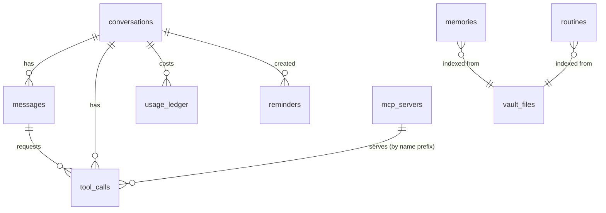

# Database & Storage — JARVIS Desktop

| Field | Value |
|---|---|
| Status | v1.0 |
| Last updated | 2026-10-06 |
| Related | [Architecture](Architecture.md) §7 · [API-Guide](API-Guide.md) §6 · [Security](Security.md) §9 |

JARVIS uses **two stores**:

| Store | Engine | Holds | Source of truth for |
|---|---|---|---|
| `jarvis.db` | SQLite (`better-sqlite3`) + FTS5 | Conversations, messages, tool calls, usage, audit, settings, reminders, MCP config, memory index | Everything *except* curated memories |
| `JarvisBrain/` | Obsidian vault (Markdown + YAML frontmatter) | Curated memories, daily conversation logs, routines | Curated memories (DB index is rebuildable from it) |

---

## 1. Locations

| Item | Path |
|---|---|
| App data root | `%APPDATA%\Jarvis\` (`app.getPath('userData')`) |
| Database | `%APPDATA%\Jarvis\jarvis.db` (+ `-wal`, `-shm`) |
| Backups | `%APPDATA%\Jarvis\backups\jarvis-YYYYMMDD-HHmm.db` |
| Secrets | `%APPDATA%\Jarvis\secrets.bin` (safeStorage-encrypted JSON) |
| MCP config | `%APPDATA%\Jarvis\mcp.json` |
| Password vault | `%APPDATA%\Jarvis\passwords.vault` (JSON: scrypt params + salt, AES-256-GCM iv/tag/data; ADR-024) |
| Phone remote certificate | `%APPDATA%\Jarvis
emote\cert.pfx` (passphrase and paired-device token hashes in `secrets.bin` as `remote_cert`, `remote_devices`) |
| WhatsApp session | `%APPDATA%\Jarvis\whatsapp-auth\` (Baileys multi-file auth state; deleted by Unlink) |
| Logs | `%APPDATA%\Jarvis\logs\` |
| Vault (default) | `%USERPROFILE%\Documents\JarvisBrain\` (configurable in onboarding) |

## 2. Connection Settings

```ts
const db = new Database(dbPath);
db.pragma('journal_mode = WAL');     // concurrent reads, crash-safe
db.pragma('synchronous = NORMAL');
db.pragma('foreign_keys = ON');
db.pragma('busy_timeout = 5000');
```

- All DB access goes through repositories in `src/main/db/repos/*`, never raw SQL in other modules.
- Use prepared statements; wrap multi-row writes in `db.transaction(...)`.
- Timestamps are **ISO-8601 UTC strings** (`2026-10-06T09:15:00.000Z`); IDs are `nanoid()` strings (21 chars) unless noted.

## 3. Schema (migration `001_init.sql`)

```sql
-- ─────────────────────────── meta ───────────────────────────
CREATE TABLE IF NOT EXISTS schema_migrations (
  version     INTEGER PRIMARY KEY,
  name        TEXT NOT NULL,
  applied_at  TEXT NOT NULL
);

CREATE TABLE settings (
  key         TEXT PRIMARY KEY,                -- e.g. 'models.default', 'voice.tts.voice'
  value_json  TEXT NOT NULL,
  updated_at  TEXT NOT NULL
);

-- ──────────────────────── conversations ─────────────────────
CREATE TABLE conversations (
  id             TEXT PRIMARY KEY,
  title          TEXT,                          -- generated by Haiku after 1st exchange
  started_at     TEXT NOT NULL,
  last_active_at TEXT NOT NULL,
  ended_at       TEXT,
  summary        TEXT,                          -- rolling summary for long chats
  source         TEXT NOT NULL CHECK (source IN ('text','voice','mixed')),
  is_private     INTEGER NOT NULL DEFAULT 0,    -- incognito: no vault log, no curator
  vault_log_path TEXT,                          -- Conversations/2026/10/2026-10-06.md
  total_input_tokens  INTEGER NOT NULL DEFAULT 0,
  total_output_tokens INTEGER NOT NULL DEFAULT 0,
  est_cost_usd   REAL NOT NULL DEFAULT 0
);
CREATE INDEX idx_conversations_last_active ON conversations(last_active_at DESC);

CREATE TABLE messages (
  id               TEXT PRIMARY KEY,
  conversation_id  TEXT NOT NULL REFERENCES conversations(id) ON DELETE CASCADE,
  seq              INTEGER NOT NULL,            -- order within conversation
  role             TEXT NOT NULL CHECK (role IN ('user','assistant')),
  content_json     TEXT NOT NULL,               -- exact API content blocks (redacted)
  text_plain       TEXT NOT NULL DEFAULT '',    -- concatenated text for search/display
  source           TEXT CHECK (source IN ('text','voice','system')),
  model            TEXT,                        -- assistant messages
  stop_reason      TEXT,
  input_tokens     INTEGER,
  output_tokens    INTEGER,
  cache_read_tokens   INTEGER,
  cache_write_tokens  INTEGER,
  created_at       TEXT NOT NULL,
  UNIQUE (conversation_id, seq)
);
CREATE INDEX idx_messages_conv ON messages(conversation_id, seq);

CREATE VIRTUAL TABLE messages_fts USING fts5(
  text_plain,
  content='messages', content_rowid='rowid',
  tokenize='porter unicode61'
);
CREATE TRIGGER messages_ai AFTER INSERT ON messages BEGIN
  INSERT INTO messages_fts(rowid, text_plain) VALUES (new.rowid, new.text_plain);
END;
CREATE TRIGGER messages_ad AFTER DELETE ON messages BEGIN
  INSERT INTO messages_fts(messages_fts, rowid, text_plain) VALUES ('delete', old.rowid, old.text_plain);
END;
CREATE TRIGGER messages_au AFTER UPDATE ON messages BEGIN
  INSERT INTO messages_fts(messages_fts, rowid, text_plain) VALUES ('delete', old.rowid, old.text_plain);
  INSERT INTO messages_fts(rowid, text_plain) VALUES (new.rowid, new.text_plain);
END;

-- ───────────────────────── tool calls ───────────────────────
CREATE TABLE tool_calls (
  id               TEXT PRIMARY KEY,
  conversation_id  TEXT NOT NULL REFERENCES conversations(id) ON DELETE CASCADE,
  message_id       TEXT REFERENCES messages(id) ON DELETE SET NULL,  -- assistant msg with tool_use
  tool_use_id      TEXT NOT NULL,              -- Claude's toolu_... id
  tool_name        TEXT NOT NULL,              -- 'open_app' | 'mcp__github__list_issues' | 'left_click'
  toolset_name     TEXT,                       -- 'computer' | 'browser' | NULL
  source           TEXT NOT NULL CHECK (source IN ('native','mcp','anthropic')),
  input_json       TEXT NOT NULL,              -- redacted
  human_summary    TEXT NOT NULL,              -- "Open Visual Studio Code"
  tier             TEXT NOT NULL CHECK (tier IN ('SAFE','CONFIRM','BLOCKED')),
  decision         TEXT NOT NULL CHECK (decision IN ('auto','approved','denied','blocked','cancelled','skipped')),
  decided_by       TEXT CHECK (decided_by IN ('policy','user_click','user_voice','kill_switch','timeout')),
  status           TEXT NOT NULL CHECK (status IN ('pending','running','success','error','not_run')),
  output_preview   TEXT,                       -- first 2 KB, redacted
  error            TEXT,
  untrusted_output INTEGER NOT NULL DEFAULT 0,
  started_at       TEXT,
  finished_at      TEXT,
  duration_ms      INTEGER,
  created_at       TEXT NOT NULL
);
CREATE INDEX idx_tool_calls_conv ON tool_calls(conversation_id, created_at);
CREATE INDEX idx_tool_calls_name ON tool_calls(tool_name, created_at);

-- ─────────────────────────── memory index ───────────────────
-- Mirror of vault Memory/** notes. Rebuildable from the vault at any time.
CREATE TABLE memories (
  id             TEXT PRIMARY KEY,
  vault_path     TEXT NOT NULL UNIQUE,         -- 'Memory/People/Pradyumna.md'
  title          TEXT NOT NULL,
  kind           TEXT NOT NULL CHECK (kind IN ('profile','preference','person','project','fact','routine','note')),
  tags_json      TEXT NOT NULL DEFAULT '[]',
  body           TEXT NOT NULL,                -- markdown body without frontmatter
  content_hash   TEXT NOT NULL,                -- sha256 of full file
  source         TEXT NOT NULL CHECK (source IN ('curator','memory_tool','user_edit','import')),
  source_conversation_id TEXT,
  created_at     TEXT NOT NULL,
  updated_at     TEXT NOT NULL,
  file_mtime_ms  INTEGER NOT NULL
);
CREATE INDEX idx_memories_kind ON memories(kind);

CREATE VIRTUAL TABLE memories_fts USING fts5(
  title, body, tags_json,
  content='memories', content_rowid='rowid',   -- external content, synced by triggers
  tokenize='porter unicode61'
);
-- memories_ai / memories_ad / memories_au triggers keep it in sync (same pattern as messages_fts)

-- Proposed memory ops awaiting Sir's review (suspicious or low-confidence)
CREATE TABLE memory_review_queue (
  id          TEXT PRIMARY KEY,
  op          TEXT NOT NULL CHECK (op IN ('ADD','UPDATE','DELETE')),
  target_path TEXT,
  proposed_markdown TEXT,
  reason      TEXT NOT NULL,
  conversation_id TEXT,
  created_at  TEXT NOT NULL,
  resolved    TEXT CHECK (resolved IN ('accepted','rejected'))
);

-- ───────────────────────── routines & reminders ─────────────
CREATE TABLE routines (
  id              TEXT PRIMARY KEY,
  name            TEXT NOT NULL UNIQUE,         -- 'Work Mode'
  vault_path      TEXT NOT NULL UNIQUE,         -- 'Routines/Work Mode.md'
  trigger_phrases_json TEXT NOT NULL,           -- ["start work mode","work setup"]
  steps_json      TEXT NOT NULL,                -- [{tool:"open_app",input:{name:"VS Code"}}, ...]
  enabled         INTEGER NOT NULL DEFAULT 1,
  last_run_at     TEXT,
  updated_at      TEXT NOT NULL
);

CREATE TABLE reminders (
  id           TEXT PRIMARY KEY,
  text         TEXT NOT NULL,
  due_at       TEXT NOT NULL,
  recurrence   TEXT,                            -- NULL | RRULE string (P1)
  status       TEXT NOT NULL CHECK (status IN ('scheduled','fired','dismissed','cancelled')),
  speak        INTEGER NOT NULL DEFAULT 1,
  created_from_conversation_id TEXT,
  created_at   TEXT NOT NULL,
  fired_at     TEXT
);
CREATE INDEX idx_reminders_due ON reminders(status, due_at);

-- ─────────────────────────── MCP ────────────────────────────
CREATE TABLE mcp_servers (
  id              TEXT PRIMARY KEY,
  name            TEXT NOT NULL UNIQUE,         -- 'playwright' (used in tool namespace)
  transport       TEXT NOT NULL CHECK (transport IN ('stdio','http')),
  command         TEXT,                         -- stdio: 'npx'
  args_json       TEXT NOT NULL DEFAULT '[]',
  url             TEXT,                         -- http
  env_secret_names_json TEXT NOT NULL DEFAULT '[]',  -- names of secrets injected as env
  enabled         INTEGER NOT NULL DEFAULT 1,
  trust_level     TEXT NOT NULL CHECK (trust_level IN ('official','community','experimental')),
  default_tier    TEXT NOT NULL DEFAULT 'CONFIRM' CHECK (default_tier IN ('SAFE','CONFIRM','BLOCKED')),
  tool_overrides_json TEXT NOT NULL DEFAULT '{}', -- {"browser_snapshot":"SAFE"}
  untrusted_output INTEGER NOT NULL DEFAULT 1,
  created_at      TEXT NOT NULL,
  updated_at      TEXT NOT NULL
);

-- ────────────────────────── usage & cost ────────────────────
CREATE TABLE usage_ledger (
  id               TEXT PRIMARY KEY,
  ts               TEXT NOT NULL,
  day              TEXT NOT NULL,               -- 'YYYY-MM-DD' local date for budgets
  model            TEXT NOT NULL,
  purpose          TEXT NOT NULL CHECK (purpose IN ('chat','curator','title','summary','desktop_agent','eval')),
  conversation_id  TEXT,
  input_tokens     INTEGER NOT NULL,
  output_tokens    INTEGER NOT NULL,
  cache_read_tokens   INTEGER NOT NULL DEFAULT 0,
  cache_write_tokens  INTEGER NOT NULL DEFAULT 0,
  est_cost_usd     REAL NOT NULL,              -- from settings price table (user-editable)
  billing          TEXT NOT NULL DEFAULT 'api' -- 'api' | 'subscription' (migration 003, ADR-010; budgets count 'api' only)
);
CREATE INDEX idx_usage_day ON usage_ledger(day);

-- ─────────────────────────── audit ──────────────────────────
CREATE TABLE audit_log (
  seq          INTEGER PRIMARY KEY AUTOINCREMENT,
  ts           TEXT NOT NULL,
  actor        TEXT NOT NULL CHECK (actor IN ('user','agent','system')),
  event        TEXT NOT NULL,                   -- 'tool.decision','tool.result','killswitch','settings.change',...
  details_json TEXT NOT NULL,                   -- redacted
  prev_hash    TEXT NOT NULL,
  hash         TEXT NOT NULL                    -- sha256(prev_hash || canonical(details))
);

-- ───────────────────────── vault sync ───────────────────────
CREATE TABLE vault_files (
  vault_path    TEXT PRIMARY KEY,
  content_hash  TEXT NOT NULL,
  mtime_ms      INTEGER NOT NULL,
  indexed_at    TEXT NOT NULL,
  last_writer   TEXT NOT NULL CHECK (last_writer IN ('jarvis','external'))
);

-- secrets are NOT stored in SQLite (see Security §8)
```

Implementation notes (Phase 1): `conversations.summary_upto_seq` records how far the rolling summary reaches; `routines.error` holds the validation error of a disabled routine; `mcp_servers.env_secret_names_json` is a map `{ "ENV_VAR": "secret_name" }`. The exact SQL lives in `src/main/db/migrations/001_init.sql`.

## 4. Entity Relationships



## 5. Common Queries

```sql
-- Episodic recall: "what did we discuss about the rate calculator?"
SELECT m.conversation_id, m.created_at, snippet(messages_fts, 0, '[', ']', '…', 12) AS hit
FROM messages_fts JOIN messages m ON m.rowid = messages_fts.rowid
WHERE messages_fts MATCH ?            -- e.g. 'rate NEAR calculator'
ORDER BY bm25(messages_fts) LIMIT 8;

-- Memory retrieval (top-k)
SELECT mem.vault_path, mem.title, mem.body
FROM memories_fts JOIN memories mem ON mem.rowid = memories_fts.rowid
WHERE memories_fts MATCH ?
ORDER BY bm25(memories_fts, 3.0, 1.0, 2.0) LIMIT 6;   -- weight title > tags > body

-- Today's spend
SELECT COALESCE(SUM(est_cost_usd),0) FROM usage_ledger WHERE day = ? AND billing = 'api';

-- Due reminders
SELECT * FROM reminders WHERE status='scheduled' AND due_at <= ? ORDER BY due_at;
```

FTS query safety: user/LLM text must be converted to a safe FTS expression (quote each term, strip operators) by `db/fts-query.ts` before `MATCH`.

## 6. Migrations

- Files: `src/main/db/migrations/NNN_name.sql`, applied in order at startup inside a transaction, recorded in `schema_migrations`.
- Never edit an applied migration; add a new one.
- Before applying migrations, take an automatic backup.
- Down-migrations are not supported; restore from backup instead.

## 7. Backup, Retention & Integrity

| Item | Policy |
|---|---|
| Automatic DB backup | On startup (if last backup > 24 h) via `VACUUM INTO` (node:sqlite, ADR-009); keep last 7 |
| Restore | Settings → Data & backups. Writes `restore-pending.json`, saves the current DB as `pre-restore.db`, restarts; the copy happens before the DB opens |
| Integrity check | `PRAGMA quick_check` on startup; on failure → offer restore from latest backup |
| Messages | Kept forever by default; Settings: auto-delete older than N days |
| Tool call output previews | 2 KB cap; full outputs not stored |
| Screenshots | Never stored |
| Logs | 14 days (file rotation) |
| Audit log | Kept forever (small); verify hash chain in Settings → Security |
| Vault | Sir's responsibility (recommend Obsidian Sync, Git, or OneDrive). Jarvis never deletes vault files except via explicit "forget" + confirmation |

**Rebuild index:** Settings → Memory → "Rebuild index" truncates `memories`, `memories_fts`, `routines`, `vault_files` and re-scans the vault.

## 8. Obsidian Vault ("JarvisBrain")

### 8.1 Folder layout

```text
JarvisBrain/
├─ README (Jarvis).md                 # human explanation of this vault; created on first run
├─ Memory/                            # ← Claude memory tool root ("/memories")
│  ├─ About Sir.md                    # core profile — always injected (keep < 1,500 tokens)
│  ├─ Preferences.md                  # how Sir likes things done — always injected
│  ├─ People/
│  │  └─ <Name>.md
│  ├─ Projects/
│  │  └─ <Project>.md
│  ├─ Facts/
│  │  └─ <Topic>.md
│  └─ Notes/                          # free-form notes Claude chooses to keep
├─ Conversations/
│  └─ 2026/
│     └─ 10/
│        └─ 2026-10-06.md             # daily log, appended per exchange
├─ Routines/
│  └─ Work Mode.md
├─ Spaces/                            # Sir's Notion-style notebooks (ADR-023)
│  └─ Finance/
│     └─ October budget.md            # a page; frontmatter `created`, body Markdown
├─ Tasks/
│  └─ Reminders.md                    # human-readable mirror of reminders table
├─ Inbox/                             # Sir drops notes here for Jarvis to process (P1)
└─ _jarvis/
   ├─ templates/                      # note templates
   └─ .jarvis-lock                    # write-lock sentinel during atomic writes
```

Only `Memory/` is exposed to the Claude memory tool; `Spaces/` is reachable through the `spaces` tool (append/create only) and both are indexed for search. `Conversations/`, `Routines/`, `Tasks/` are written by app code.

### 8.2 Memory note format

```markdown
---
id: mem_V1StGXR8_Z5jdHi6B
kind: person            # profile | preference | person | project | fact | routine | note
title: Pradyumna
tags: [colleague, backend, avaan-website]
created: 2026-10-06T09:15:00Z
updated: 2026-10-06T09:15:00Z
source: curator         # curator | memory_tool | user_edit
---

# Pradyumna

- Backend / database teammate on [[Avaan Website]].
- Works with Sir on API integration for booking pages.
- Prefers async updates over calls (inferred)

## History
- 2026-10-06: First mentioned while discussing [[Avaan Website]] API work.
- Works from the Pune office (until 2026-10)
```

Rules: facts are short bullet points; link related notes with `[[wikilinks]]` (builds Obsidian's graph); no secrets (redaction runs on every write); no instructions to the AI inside memory notes.

Provenance and history (2.17, ADR-041): a fact Sir stated is plain; a curator guess ends in ` (inferred)`; a fact taken from something the assistant read ends in ` (read)` (those always pass the review queue first). `## History` is always the last section: when the curator marks a fact `outdated`, it leaves the list above and is appended there as `- <fact> (until YYYY-MM)`; new facts are always written above it.

### 8.3 Daily conversation log format

```markdown
---
date: 2026-10-06
type: conversation-log
conversations: [c_8Hk2..., c_Zp91...]
---

# Conversations — Tuesday, 6 October 2026

## 09:15 · Work setup  ^c_8Hk2
**Sir (voice):** Jarvis, open my work setup.
**Jarvis:** Opening VS Code, Chrome and Notion. Your workspace is ready, sir.
> Actions: `open_app` VS Code ✅ · `open_app` Chrome ✅ · `open_app` Notion ✅

## 11:40 · Rate calculator question  ^c_Zp91
**Sir:** What did we decide about the GST toggle on the rate calculator?
**Jarvis:** On 1 October you decided to show GST-inclusive prices by default…
> Memory used: [[Avaan Excess]]
```

### 8.4 Routine note format

```markdown
---
kind: routine
name: Work Mode
triggers: ["start work mode", "work setup", "let's get to work"]
enabled: true
steps:
  - tool: open_app
    input: { name: "Visual Studio Code" }
  - tool: open_url
    input: { url: "https://github.com/AvaanTech" }
  - tool: open_app
    input: { name: "Notion" }
  - tool: set_volume
    input: { level: 30 }
---

# Work Mode
Opens Sir's standard development workspace.
```

Routine steps are validated against tool schemas on load; invalid routines are disabled with an error shown in Settings. A step `tool: ask_to_continue` with `input: { message: "…" }` (2.17) asks Sir before going on; a "no" stops the routine there. Browser routines saved by `save_browser_routine` (2.18) use `jarvis_browser` `{action: open, url}`, `browser_act` `{action: click|select|press|scroll, target: {role, name}}` and `browser_type` `{target, text, clear, submit}`: controls by role and name, found on the page when the step runs.

### 8.5 Write safety (vault-service)

1. Resolve target via path guard: must be inside vault root (memory tool: inside `Memory/`).
2. Redact content.
3. If file exists: compare current `content_hash` with the last known hash; if Sir edited it in between, **merge** (append under `## Updates from Jarvis`) instead of overwriting.
4. Write to `<file>.tmp` → `fs.rename` (atomic on same volume).
5. Update `vault_files` (`last_writer='jarvis'`) so the watcher ignores our own write.
6. Re-index the file.

### 8.6 Watcher

`chokidar.watch(vaultRoot, { ignoreInitial: true, awaitWriteFinish: { stabilityThreshold: 500 } })`
- `add`/`change` → if hash differs from `vault_files` → re-index (`last_writer='external'`).
- `unlink` → remove from index (memory deleted by Sir).
- Ignore `.obsidian/`, `_jarvis/`, `*.tmp`.

## 9. Implementation Notes (Phase 3)

- **Block ids** in daily logs use dashes (`^c-8Hk2`): Obsidian block ids allow only letters, digits and `-`, so `_` in conversation ids is replaced. Each exchange ends with an HTML comment (`<!-- c-8Hk2 -->`) so consecutive exchanges of one conversation share one heading.
- **Merge rule** (§8.5 step 3): Jarvis overwrites a note only if the file on disk is exactly what Jarvis last wrote, or the caller read the current version first (`str_replace`, `insert`, curator `UPDATE`). Otherwise the new text is appended under `## Updates from Jarvis`.
- **Routines** may not use `run_routine`, `run_powershell`, `delegate_desktop_task` or `memory` as steps (no recursion or unattended shell/GUI control); such routines are loaded disabled with an error.
- **Curator review queue**: confidence 0.5–0.8, instruction-like facts (Security.md §6.6), and `flag`s go to `memory_review_queue`; Sir accepts or discards them in the Memory browser.
- `Tasks/Reminders.md` is regenerated whenever reminders change or fire.

## 10. Tables and changes added after v1.0

Full migration list: [REFERENCE.md → Database migrations](REFERENCE.md#database-migrations).

| Migration | Change |
|---|---|
| `003_usage_billing.sql` | `usage_ledger.billing` = `api` \| `subscription` \| `local`; budgets sum `api` only |
| `004_usage_purposes.sql` | Purposes `intent`, `research`, `briefing`, `copilot`, `task` (table rebuilt) |
| `005_meals.sql` | `meals(id, ts, day, description, calories, protein_g, carbs_g, fat_g, conversation_id)` |
| `006_dictations.sql` | `dictations(id, ts, raw_text, final_text, target_app)`, newest 200 kept |
| `007_scheduled_tasks.sql` | `scheduled_tasks(id, name, kind briefing\|task\|checkin, prompt, schedule_json, enabled, speak, save_to_vault, next_run_at, last_run_at, last_status, last_conversation_id, created_at)` |
| `008_remote_decisions.sql` | `tool_calls.decided_by` gains `user_remote` (Telegram) (table rebuilt) |
| `009_embeddings.sql` | `embeddings(kind memory\|message, ref, hash, vector BLOB)`: on-device MiniLM vectors (384 × float32) for semantic search; rows for deleted notes/messages are pruned on each sync |
| `010_planner.sql` | Tasks and Calendar. `todo_lists(id, name, color, icon, sort_order)`; `todos(id, list_id → todo_lists ON DELETE SET NULL = Inbox, parent_id → todos ON DELETE CASCADE = subtasks, title, notes, status todo\|doing\|done, priority 1–4, due_date, due_time, duration_min, remind_at, reminded, recurrence_json, tags_json, starred, sort_order, created_at, updated_at, completed_at)`; `calendars(id, name, color, visible)`; `events(id, calendar_id → calendars ON DELETE CASCADE, title, notes, location, start_at, end_at, all_day, recurrence_json, exdates_json, reminders_json, …)`; `event_reminders_fired(event_id, occurrence, minutes)` so a reminder never fires twice. Dates and times are **local wall-clock text** (`2026-10-09T17:30`), so repeats keep their time across daylight saving. Repeat rule JSON: `{freq daily\|weekly\|monthly\|yearly, interval, byDay?[0–6], until?, count?}`. Rows are upserted, never `REPLACE`d (that would cascade-delete subtasks). |
| `011_list_details.sql` | Richer task lists (2.8): `todo_lists` gains `description TEXT ''` (shown on the list card), `wip_limit INTEGER NULL` (most tasks in Doing before the board warns; NULL = none) and `archived INTEGER 0/1` (hidden from All lists). |
| `012_strategies.sql` | Approaches that worked (2.17, ADR-041): `strategies(id, request ≤ 300 chars, tools_json, successes, failures, created_at, updated_at)`; tool names only, newest 500 kept; never from private chats, automations, fast commands or tainted turns. |
| `013_npcs.sql` | NPCs (2.21): `npcs(id, name UNIQUE NOCASE, role, emoji, color, brain, instructions, tools_json, enabled, template_id, desk, conversation_id → conversations, created_at, updated_at)`; `npc_messages(id, channel 'office'\|'dm:<npc id>'\|'meeting:<meeting id>', author 'sir'\|'jarvis'\|npc id, text, mentions_json, tainted 0/1, created_at)`; `npc_meetings(id, topic, attendees_json, status running\|done\|stopped, summary, created_at)`. `conversations` gains `kind TEXT 'chat'` (`'npc'` = an NPC's hidden work conversation holding its tool calls and costs; the history list shows `chat` only). Deleting an NPC removes its DM channel; office and meeting messages stay. |
| `014_ai_connections.sql` | Integrations step 3 (2.25): `ai_connections(id 'conn_<provider>'\|'conn_<provider>_<n>', provider, label, secret UNIQUE — the secret's name in secrets.bin, model, created_at)`; `ai_models(connection_id → ai_connections ON DELETE CASCADE, model, source 'live'\|'manual'\|'cached', favourite 0/1, enabled 0/1, seen_at, PK(connection_id, model))`. Each provider's own row (`conn_<provider>`, secret = the provider's secret) is created on first use; its chosen model stays in setting `llm.cloud.models`. Removed extra keys stay as rows with `removed = 1` (key deleted) so their id is never reused. |
| `015_ai_runs.sql` | Integrations step 4 (2.26): `ai_runs(id 'run_…', mode compare\|review\|chain, prompt, status running\|done\|partial\|failed\|cancelled, created_at, finished_at)`; `ai_run_steps(run_id → ai_runs ON DELETE CASCADE, idx, brain, label, role answer\|review\|stage, instruction, status queued\|running\|done\|failed\|cancelled, output, error, model, started_at, finished_at, input_tokens, output_tokens, cost_usd, PK(run_id, idx))`. Usage rows of a run carry its id in `usage_ledger.conversation_id`. The history shows the last 50; older than the last 200 are deleted when a run starts. |
| `016_usage_sources.sql` | Integrations step 5 (2.27): `usage_ledger` gains `source` ('anthropic'\|'claude-plan'\|'local'\|'cloud'\|connection id; NULL before 2.27) and `price` ('live'\|'table'\|'fallback'\|'free'), index `(source, day)`; `ai_models` gains `in_per_mtok`, `out_per_mtok`, `cache_read_per_mtok`, `cache_write_per_mtok` (USD per million tokens from a gateway's list, NULL = unknown). |

Files outside the DB (all under `%APPDATA%\jarvis`): `models/` (verified voice models), `skills/` (SKILL.md folders), `claude-code/` (empty working folder for subscription mode), `cli-brains/` (empty working folder for the ChatGPT / Antigravity apps). Vault folders added: `Briefings/`, `Research/`, `NPCs/<name>/Memory.md` (each NPC's own memory, from its `REMEMBER:` lines), `NPCs/Meetings/<date> <topic>.md` (meeting minutes).
